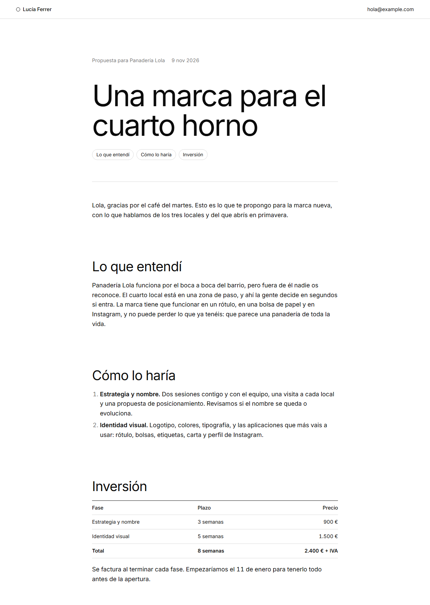

# Freelance Backoffice

El backoffice de un autónomo en un repo de GitHub, con Claude Code como administrativo.

Clientes, proyectos, propuestas, facturas, gastos y trimestres viven en archivos JSON y PDF de tu repo privado. Tú le dices a Claude Code lo que ha pasado ("factura a Acme la Fase 1", "apunta este gasto", "cierra el 4T") y él hace el trabajo con las skills de este repo. Una web minimalista te lo enseña todo, y tus clientes ven su propuesta o su proyecto en un espacio privado, cada persona con su enlace.

Funciona en Cloudflare Pages y GitHub Actions, en sus planes gratuitos. No hay base de datos ni cuenta en ningún SaaS: si mañana lo dejas, te quedas con tus archivos.


## Qué hace

- **Clientes y proyectos**, con estados (contacto, propuesta, activo, terminado…), hitos con precio y fecha, horas y seguimiento de propuestas sin respuesta.
- **Facturas** con numeración correlativa, IVA y retención de IRPF según el cliente (España, UE o fuera), PDF, cobros y rectificativas. Una factura emitida no se toca.
- **Gastos** a partir del PDF o la foto de la factura: IVA deducible, inversión del sujeto pasivo para proveedores extranjeros, % de afectación, cambio de moneda del BCE y equipos por amortizar.
- **Gastos fijos** (cuota de autónomos, suscripciones) con previsión mes a mes: qué ha llegado con factura y qué falta.
- **Trimestres**: estimación del 303 y del 130, resumen en PDF, libros en Excel y un ZIP con todo para la gestoría. También un ZIP por mes.
- **Espacios de cliente**: una página privada por propuesta o proyecto, escrita en Markdown, con sus hitos, facturas y archivos. Se entra con un enlace personal que puedes revocar cuando quieras. En el repo solo queda el hash de cada clave.
- **"Lo que falta"**: el admin te dice qué tienes pendiente y qué decirle a Claude Code para resolverlo.
- **El extracto del banco**: cruza el CSV con tus facturas y gastos, y te dice qué cobros cuadran y qué cargos no tienen factura.

| Espacio de un proyecto | Propuesta |
|---|---|
|  |  |

## Para quién es

Para autónomos en España que ya usan [Claude Code](https://claude.com/claude-code) y se manejan con un repo de GitHub: desarrollo, diseño, consultoría, formación. La fiscalidad incluida es la española (IVA, IRPF, modelos 303 y 130, estimación directa simplificada).

## Empezar

1. Crea tu repo con **Use this template** en GitHub y hazlo **privado**: va a guardar tus datos fiscales y tus facturas.
2. Clónalo, abre Claude Code dentro y dile: **«configura mi backoffice»**. Te pedirá tus datos, tu cuota de autónomos y tus suscripciones, y te enseñará el admin en local.
3. Para publicarlo (admin y espacios de cliente en tu dominio), sigue [docs/instalar.md](docs/instalar.md). Son unos 20 minutos en Cloudflare.

Necesitas Python 3.10 o superior y Google Chrome (para los PDF). Nada más que instalar.

### Probar con la demo

```
BACKOFFICE_DATOS=demo python backoffice.py servir
```

En PowerShell: `$env:BACKOFFICE_DATOS="demo"; python backoffice.py servir`. Abre el admin con los datos de una diseñadora inventada, Lucía Ferrer: tres clientes, facturas, gastos, un trimestre presentado y dos espacios.

## Cómo se usa

Le hablas a Claude Code y él usa estas skills:

| Skill | Le dices… |
|---|---|
| `configurar` | «configura mi backoffice» |
| `backoffice` | «nuevo cliente: …», «he terminado la Fase 1 de Acme», «hoy 3 h con Acme», «¿qué me deben?» |
| `factura` | «factura a Acme la Fase 1», «me ha pagado Acme», «la 2026-004 está mal» |
| `gasto` | «apunta este gasto» (con el PDF), «revisa el Gmail», «¿cuánto aparto este trimestre?», «cierra el 4T», «el ZIP de noviembre» |
| `espacio` | «hazle una propuesta a Panadería Lola», «actualiza el espacio de Acme», «dale acceso a Ana» |

Cada cambio acaba en un commit. Al hacer `git push`, GitHub Actions publica el admin y los espacios.

Todo pasa por `python backoffice.py`, que también puedes usar a mano. Sin argumentos, lista los comandos. El formato de los datos está en [docs/datos.md](docs/datos.md).

## Seguridad

- El repo tiene que ser privado.
- `/admin/` está detrás de Cloudflare Access (login con tu email) y de una segunda comprobación en el servidor. Sin configurar, responde 403.
- Cada espacio se abre solo con un enlace personal. La clave se enseña una vez y en el repo solo queda su SHA-256. Revocar un enlace no afecta a los demás.
- Todo se sirve con `noindex` y sin `Referer`.

## Aviso

Freelance Backoffice es software libre que se ofrece tal cual, sin garantía (ver [LICENSE](LICENSE)). **No es asesoramiento fiscal ni contable.** Las cifras del 303 y el 130 son una estimación para revisarla con tu gestoría: no aplican prorrata, la deducción del art. 110.3.c, gastos de difícil justificación ni amortizaciones. Tú eres responsable de lo que facturas y de lo que presentas.

**Verifactu.** Freelance Backoffice no envía las facturas a la Agencia Tributaria ni las firma. Cuando el reglamento de sistemas de facturación te sea obligatorio (para autónomos está previsto desde julio de 2027), cumplirlo es responsabilidad tuya: tendrás que facturar con un sistema que lo cumpla.

## Licencia

MIT. Hecho por [Borja Pérez Francés](https://borjaperezfrances.com), que lleva así su propio negocio.
