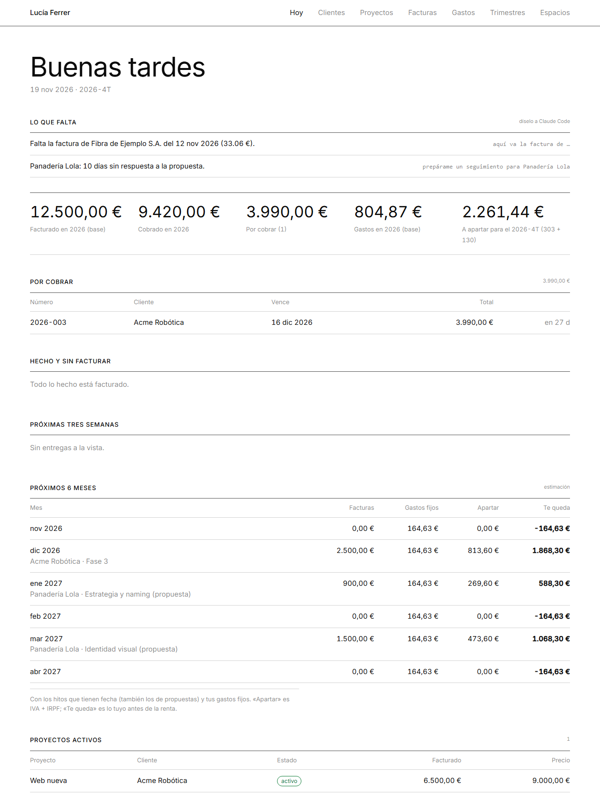
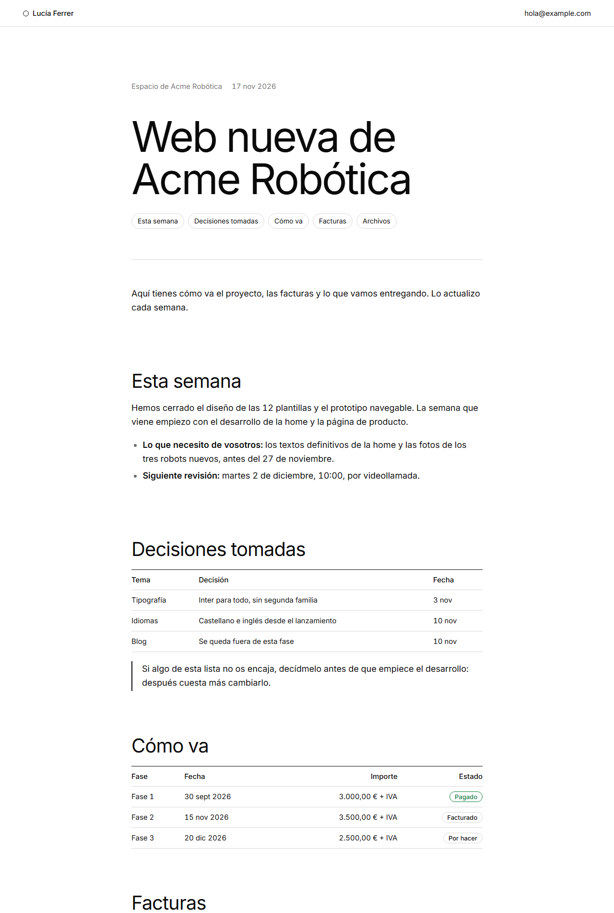

# Freelance Backoffice

El backoffice de un autónomo en un repo de GitHub, con tu agente de código como administrativo.

Tus clientes, proyectos, propuestas, facturas, gastos y trimestres son archivos JSON y PDF en tu repo privado. Le cuentas a tu agente de código (Claude Code, Pi, Codex, OpenCode…) lo que ha pasado («factura a Acme la Fase 1», «apunta este gasto», «cierra el 4T») y él hace el trabajo. Una web sencilla te lo enseña todo, y cada cliente ve su propuesta o su proyecto en una página privada, con un enlace personal.

Funciona con los planes gratuitos de Cloudflare y GitHub. No hay base de datos ni cuenta en ningún SaaS: si un día lo dejas, te quedas con tus archivos.

**Pruébalo sin instalar nada:** [backoffice.borjaperezfrances.com/admin/](https://backoffice.borjaperezfrances.com/admin/), con los datos de una diseñadora inventada.



## Qué hace

- **Clientes y proyectos**, con su estado, hitos con precio y fecha, horas y seguimiento de las propuestas que no contestan.
- **Facturas** numeradas, con el IVA y la retención que tocan según el cliente (España, UE o fuera), su PDF, cobros y rectificativas. Una factura emitida no se puede cambiar, y GitHub lo comprueba en cada push.
- **Gastos** a partir del PDF o la foto de la factura: IVA deducible, inversión del sujeto pasivo con proveedores extranjeros, porcentaje de uso profesional, cambio de moneda del BCE y equipos que se amortizan.
- **Gastos del correo**: tu agente busca en tu Gmail o tu Outlook las facturas nuevas de tus proveedores y las apunta. Si no quieres conectar el correo, las dejas en una carpeta.
- **Gastos fijos** (cuota de autónomos, suscripciones), con lo que ha llegado este mes y lo que falta.
- **Trimestres**: estimación del 303 y del 130, resumen en PDF, libros en Excel y un ZIP para la gestoría. También uno por mes.
- **El extracto del banco**: lo cruza con tus facturas y gastos y te dice qué cobros cuadran y qué cargos no tienen factura.
- **Proyectos por fases**: las fases con la actual marcada, los entregables como carpetas, documentos en Markdown que salen como presentación o documento con su PDF y sus versiones, decisiones, pruebas y un resumen por capítulos. Tu cliente puede ver el proyecto entero, igual que tú y en solo lectura. Ver [docs/trabajo.md](docs/trabajo.md).
- **Espacios de cliente**: una página privada por propuesta o proyecto, escrita en Markdown, con sus hitos, facturas y archivos. Cada persona entra con su enlace, y puedes quitárselo cuando quieras.
- **Melso**: si llevas los impuestos con [Melso](https://melso.ai), le manda tus facturas y gastos.

| Espacio de un proyecto | Propuesta |
|---|---|
|  |  |

## Para quién es

Para autónomos en España que ya trabajan con un agente de código (Claude Code, Pi, Codex, OpenCode…) y tienen cuenta en GitHub: gente de desarrollo, diseño, consultoría o formación. No hace falta programar, pero sí no asustarse con una terminal. La fiscalidad es la española: IVA, IRPF, modelos 303 y 130 y estimación directa simplificada.

## Empezar

Necesitas Python 3.10 o superior, git, Google Chrome (para los PDF de las facturas y los documentos) y tu agente de código. Para publicarlo, también [gh](https://cli.github.com) y una cuenta de Cloudflare.

Las instrucciones para el agente están en `CLAUDE.md` y las skills, en `.claude/skills/`. Claude Code las lee solo. Para Codex, Pi, OpenCode y los que buscan `AGENTS.md`, ese archivo les dice dónde está cada cosa.

1. En GitHub, **Use this template → Create a new repository**, y márcalo como **privado**: va a guardar tus datos fiscales y tus facturas.
2. Clónalo, abre tu agente dentro y dile **«configura mi backoffice»**. Te pedirá tus datos, tu cuota de autónomos y tus suscripciones, conectará el correo para los gastos si quieres y te enseñará el admin en tu ordenador.
3. Para tenerlo en tu dominio, con los espacios de cliente: [docs/instalar.md](docs/instalar.md). Con `python backoffice.py cloudflare` es un comando y un par de clics.

Para comprobar en cualquier momento que todo está en su sitio: `python backoffice.py doctor`.

### Probar con la demo

En la web: el [admin](https://backoffice.borjaperezfrances.com/admin/), el [espacio de un proyecto](https://backoffice.borjaperezfrances.com/c/acme-robotica-web/) y el [de una propuesta](https://backoffice.borjaperezfrances.com/c/panaderia-lola/). Se actualiza con cada versión.

En tu ordenador:

```
BACKOFFICE_DATOS=demo python backoffice.py servir
```

En PowerShell: `$env:BACKOFFICE_DATOS="demo"; python backoffice.py servir`. Se abre el admin con los datos de una diseñadora inventada, Lucía Ferrer: tres clientes, facturas, gastos, un trimestre presentado y dos espacios.

## Cómo se usa

Le hablas a tu agente y él usa estas skills:

| Skill | Le dices… |
|---|---|
| `configurar` | «configura mi backoffice», «configura los gastos del correo» |
| `backoffice` | «nuevo cliente: …», «he terminado la Fase 1 de Acme», «hoy 3 h con Acme», «¿qué me deben?» |
| `factura` | «factura a Acme la Fase 1», «me ha pagado Acme», «la 2026-004 está mal» |
| `gasto` | «apunta este gasto» (con el PDF), «revisa los gastos del correo», «¿cuánto aparto este trimestre?», «cierra el 4T» |
| `trabajo` | «monta las fases de Acme», «escribe la presentación para la reunión», «marca el diseño como revisado», «comparte el proyecto con el cliente» |
| `espacio` | «hazle una propuesta a Panadería Lola», «actualiza el espacio de Acme», «dale acceso a Ana» |
| `melso` | «conecta Melso», «manda lo pendiente a Melso» |
| `mantener` | «¿hay versión nueva?», «haz una copia de mis datos», «¿está todo bien?» |

Cada cambio acaba en un commit, y con cada `git push` GitHub publica el admin y los espacios.

Debajo de todo está `python backoffice.py`, que también puedes usar a mano: sin argumentos, lista los comandos.

## Melso

Si llevas tus impuestos con [Melso](https://melso.ai), la gestoría online, el backoffice les manda lo que haces aquí y no tienes que subirlo dos veces:

- cada **gasto**, con el PDF de su factura;
- cada **factura emitida**, con su PDF, y el cliente si Melso no lo tiene;
- los **cobros**, que se marcan como cobrados en Melso.

También **compara el 303**: pone tu estimación al lado de la que ha calculado Melso y, si no cuadran, busca qué falta en cada lado.

Las facturas se siguen emitiendo aquí, con tu numeración. El backoffice no emite facturas en Melso, ni aprueba o presenta impuestos, ni borra nada allí: eso lo haces tú en Melso.

Se conecta con el servidor MCP de Melso (`https://mcp.melso.ai/mcp`, por HTTP). Entras con tu cuenta de Melso y no hay ninguna clave en el repo. Añádelo a tu agente como cualquier otro servidor MCP; en Claude Code, por ejemplo:

```
claude mcp add --transport http melso https://mcp.melso.ai/mcp
```

y después `/mcp`, eliges **melso** y te autenticas. Luego dile a tu agente «conecta Melso»: te preguntará desde qué fecha te lleva Melso los impuestos, porque lo anterior no se manda. A partir de ahí, «manda lo pendiente a Melso». El admin te avisa cuando hay algo por mandar, y `python backoffice.py melso pendiente` te lo enseña en la terminal.

Lo que se ha mandado, y con qué id quedó en Melso, se guarda en `datos/melso.json`.

**Todavía no se ha probado con una cuenta real de Melso**: la primera vez, mira con calma lo que hace. Todos los detalles están en [docs/melso.md](docs/melso.md).

## Documentación

- [Publicar en Cloudflare](docs/instalar.md)
- [Proyectos por fases](docs/trabajo.md)
- [Gastos del correo](docs/gastos-correo.md)
- [Melso](docs/melso.md)
- [Actualizar](docs/actualizar.md)
- [Copias de seguridad](docs/copias.md)
- [Si algo falla](docs/problemas.md)
- [El formato de los datos](docs/datos.md)
- [Cambios de cada versión](CHANGELOG.md)

## Seguridad

- El repo tiene que ser privado: guarda tus datos fiscales y tus facturas. `doctor` lo comprueba.
- `/admin/` está detrás de Cloudflare Access (entras con tu email) y de una segunda comprobación en el servidor. Si falta configuración, responde 403: nunca queda abierto.
- Cada espacio se abre solo con un enlace personal. La clave se enseña una vez y en el repo solo queda su huella. Quitarle el enlace a alguien no afecta a los demás.
- Si un push cambia una factura emitida, GitHub no publica. Esto vale uses el agente que uses.
- En Claude Code, `.claude/settings.json` además le impide reescribir la historia de git o editar a mano una factura emitida. Si usas otro agente, ponle reglas parecidas en sus permisos.
- Los tokens (Cloudflare, GitHub) los escribes tú en la terminal, nunca en el chat del agente. No se guardan en el repo.
- Todo se sirve con `noindex` y sin `Referer`.

## Aviso

Freelance Backoffice es software libre y se ofrece tal cual, sin garantía (ver [LICENSE](LICENSE)). **No es asesoramiento fiscal ni contable.** El 303 y el 130 que calcula son una estimación para revisarla con tu gestoría: no aplica prorrata, la deducción del art. 110.3.c, gastos de difícil justificación ni amortizaciones. Lo que facturas y lo que presentas es responsabilidad tuya.

**Verifactu.** Freelance Backoffice no envía las facturas a la Agencia Tributaria ni las firma. Cuando el reglamento de sistemas de facturación te sea obligatorio (para autónomos está previsto desde julio de 2027), tendrás que facturar con un sistema que lo cumpla.

## Licencia

MIT. Hecho por [@borjaperfra](https://github.com/borjaperfra).
